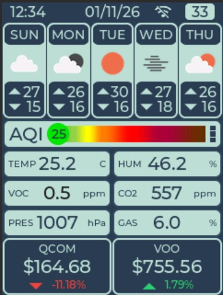
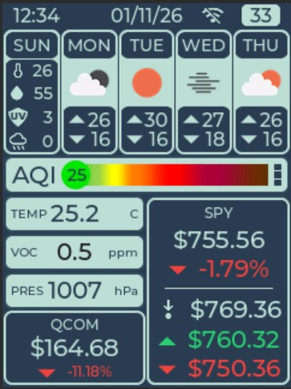
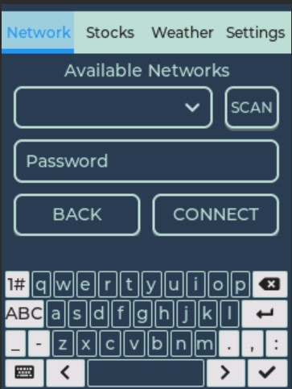

# SmartInfo - IoT Smart Dashboard

## Overview

**SmartInfo** is an ESP32 touch dashboard combining environmental sensing, stock quotes, weather forecasts and device settings. It uses **LVGL 9.1.0**, **ESP-IDF v5.4.0** and **SquareLine Studio**, with an always-on display and battery-aware operation.

## UI Screenshots

The touch interface combines weather, environmental sensing, stock quotes and device settings. Click a screenshot to view it at full size.

| Dashboard | Expanded details | Network setup |
| --- | --- | --- |
| [](EXTRA/Media/screen_1.jpg) | [](EXTRA/Media/screen_1_extendend.jpg) | [](EXTRA/Media/screen_2.jpg) |

- **Dashboard:** The header shows time, date, Wi-Fi status and battery percentage. Below it are a five-day forecast, an air-quality indicator, temperature, humidity, pressure, gas-related readings and two stock quotes with their price changes. CO2-equivalent and VOC values are estimates provided by BSEC.
- **Expanded details:** Additional panels show information for a selected forecast day and a selected stock, including previous close, daily high and daily low, while keeping the rest of the dashboard visible.
- **Network setup:** Scan for available Wi-Fi networks, select a network and enter its password using the on-screen keyboard. The tab bar also provides access to stock selection, weather configuration and device settings.

## Contents

- [Features and Operation](#features-and-operation)
- [Hardware and Wiring](#hardware-and-wiring)
- [Battery Monitoring](#battery-monitoring)
- [Battery Power Efficiency](#battery-power-efficiency)
- [Software Architecture and UI Development](#software-architecture-and-ui-development)
- [Configuration and Calibration](#configuration-and-calibration)
- [Building and Firmware Updates](#building-and-firmware-updates)
- [Testing and Troubleshooting](#testing-and-troubleshooting)
- [Hardware Design Files and Tools](#hardware-design-files-and-tools)

## Features and Operation

### Dashboard and Touch Controls

The dashboard shows time as `HH:MM`, date as `DD/MM/YY`, Wi-Fi status and battery percentage. Network, Stocks, Weather and Settings tabs provide configuration through touch controls and an on-screen keyboard. Brightness is adjustable; the [power policy](#battery-power-efficiency) controls idle dimming.

### Environmental Readings

The Bosch BME680 and BSEC provide an air-quality index with accuracy indicators, CO2-equivalent and breath-VOC estimates, temperature, humidity, pressure and gas-related readings. Color-coded gauges summarize air quality. Displayed temperature and humidity use BSEC compensation; humidity is rounded to the nearest integer, with halves rounded upward and no math-library dependency. The underlying sensor values retain their precision.

### Stock Quotes and Market Status

Two configurable ticker symbols show price, percentage change, daily high/low and previous close. Price-change colors and direction indicators show gains or losses.

Ticker-symbol labels on the dashboard and expanded panels use `2ECC71` while the market is open and `BBDED6` while closed or time is not yet valid. Colors are checked at initialization and minute changes, independently of Wi-Fi and quote updates. At 16:00 New York time the labels show closed while the final scheduled quote is fetched. See [Network Scheduling](#network-scheduling) for market hours and refresh rules.

### Weather, Wi-Fi and Time

The five-day forecast includes high/low temperatures, precipitation, UV index and wind, with icons and expanded daily details. City search changes the forecast location. Background requests keep network work out of the touch UI.

The Wi-Fi screen supports scanning, network selection and saved credentials. NTP synchronizes time with timezone support. The status-bar Wi-Fi icon follows the connection state, so disconnected periods between scheduled sessions are expected. Opening the Network tab keeps Wi-Fi available until that tab is left.

## Hardware and Wiring

### Reference Hardware and Power

| Part | Reference setup |
| --- | --- |
| Microcontroller | ESP32 DevKit V1 / ESP-WROOM-32, 4 MB flash, no usable PSRAM detected |
| Display and touch | 240x320 ILI9341 SPI LCD with XPT2046 touch controller |
| Environmental sensor | Bosch BME680 on I2C |
| Battery | Two Panasonic NCR18650B cells in parallel |
| Power board | 18650 battery shield V8 with TP5602B |
| Power connections | Shield 5 V output to ESP32 VIN; ESP32 3V3 to LCD/BME680 VCC; shared GND |

Pin definitions are maintained in `components/bsp/include/bsp.h`. The tables below describe the reference wiring, including the disconnected LCD SDO used during touch validation.

### BME680 Wiring

| BME680 pin | Wire color | ESP32 DevKit V1 connection |
|---|---|---|
| SDA | Green | GPIO 21 |
| SCL | Yellow | GPIO 22 |
| GND | Black | GND |
| VCC | Red | 3V3 (3.3 V) |

### LCD and Touch Wiring

Share SCK and MOSI between the LCD and touch controller. In the working reference setup, touch T_DO connects directly to GPIO19 and LCD SDO is left disconnected. The LCD still receives display data through MOSI.

| LCD/touch pin | Wire color | ESP32 DevKit V1 connection |
|---|---|---|
| LCD_BACKLIGHT | Green | GPIO 4 |
| LCD_SPI_CLK | Blue | GPIO 18 |
| LCD_TOUCH_CLK | Blue | GPIO 18, bridged to LCD_SPI_CLK |
| LCD_SPI_MISO / SDO | Green (unused) | Disconnected |
| LCD_TOUCH_DO / T_DO | Green | GPIO 19, direct wire |
| LCD_SPI_MOSI | Yellow | GPIO 23 |
| LCD_TOUCH_DIN | Yellow | GPIO 23, bridged to LCD_SPI_MOSI |
| LCD_DC | Blue | GPIO 32 |
| LCD_RST | White | GPIO 26 |
| LCD_SPI_CS | Green | GPIO 25 |
| LCD_TOUCH_CS | White | GPIO 13 |
| LCD_TOUCH_INT | Yellow | GPIO 27 |
| GND | Black | GND |
| VCC | Red | 3V3 (3.3 V) |

### Battery Interface Pins

| Signal | ESP32 connection | Interface connection |
| --- | --- | --- |
| Battery sense | GPIO34, ADC1 channel 6, `BSP_BAT_SENSE` | White wire from R1/R2/C1 midpoint |
| Charger sense | GPIO35, ADC1 channel 7, `BSP_CHARGER_SENSE` | R3/R4/C2 midpoint |
| Shield keep-alive | GPIO33, `BSP_BAT_KEEP_ALIVE` | R5 to the 2N3904 base |

### Interface PCB Wiring

J1 connects to the V8 shield on the left; J2 connects to the ESP32 on the right. All GND symbols join the same ground connection between J1 pin 4 and J2 pin 4.

```text
+--------------------------------------------------------------------+
|                      SMARTINFO INTERFACE PCB                       |
|                                                                    |
| J1: TO V8 SHIELD                              J2: TO ESP32         |
|                                                                    |
| BATTERY VOLTAGE                                                    |
|                                                                    |
| 1 BAT+ --[R1 100k]--+------------------------- 1 GPIO34            |
|                     |                                              |
|                     +--[R2 100k]-- GND                             |
|                     |                                              |
|                     +--|| C1 100nF-- GND                           |
|                                                                    |
|                                                                    |
| CHARGER PRESENCE                                                   |
|                                                                    |
| 2 CHG_IN_5V --[R3 100k]--+---------------------- 2 GPIO35          |
|                          |                                         |
|                          +--[R4 33k]-- GND                         |
|                          |                                         |
|                          +--|| C2 100nF-- GND                      |
|                                                                    |
|                                                                    |
| ELECTRONIC BUTTON PRESS                                            |
|                                                                    |
| 3 POWER_UP_KEY -----------+                                        |
|                           |                                        |
|                   +-------C-------+                                |
|                   |               |                                |
|                   |  Q1 2N3904    B----+--[R5 10k]-- 3 GPIO33      |
|                   |               |    |                           |
|                   +-------E-------+    |                           |
|                           |        [R6 100k]                       |
|                           |            |                           |
|                          GND          GND                          |
|                                                                    |
| COMMON GROUND                                                      |
|                                                                    |
| 4 GND ----------------------------------------- 4 GND              |
|                                                                    |
+--------------------------------------------------------------------+
```

`BAT+` is the raw battery-positive tap. `CHG_IN_5V` is the external charger's input, not the shield's boosted 5 V output. `POWER_UP_KEY` connects to shield KEY (TP5602B pin 17), in parallel with the manual button. Use shield output GND, not the battery-holder negative lug. The Q1 drawing identifies electrical connections; verify the actual transistor pinout before soldering.

Use 1% divider resistors and 100 nF ceramic capacitors near the ADC connections. At 4.2 V BAT+, GPIO34 should see about 2.1 V; at 5 V charger input, GPIO35 should see about 1.24 V. Verify these voltages before connecting the ESP32. Never connect raw BAT+, charger VIN or KEY directly to a GPIO. See the [off-state limitation](#battery-interface-limitations) before relying on complete power-off isolation.

## Battery Monitoring

### Voltage and Percentage

Battery voltage is sampled every ten seconds using GPIO34. Each sample averages 32 back-to-back ADC conversions, applies ADC calibration and scales the divider voltage by two.

A piecewise-linear lookup table estimates remaining charge from voltage and rounds to the nearest integer. The current curve clamps to 0% at or below 3,000 mV and 100% at or above 4,150 mV. This is a load-dependent estimate, not a direct measurement of remaining capacity. Settings show percentage and millivolts; the status bar shows the percentage number without a `%` symbol. The [plotting tool](#hardware-design-files-and-tools) visualizes the programmed curve.

### Charger Presence and Runtime Counters

Charger presence is sampled once per second through GPIO35. Two consecutive readings at or above 0.8 V confirm connected; two at or below 0.4 V confirm disconnected. These thresholds apply at the ADC pin, after the divider. The intervening range retains the last confirmed state.

When external charger power is detected, the raw-voltage label shows `Charging`; percentage calculation continues unchanged. This detects input power, not charging current, so the label also applies when a connected battery is full.

Current and previous battery-run counters use `HH:MM:SS`. The current counter accumulates powered-on time while disconnected from the charger. Reconnecting saves a nonzero run as the previous counter and resets the current one. NVS stores changed counters once per minute and on confirmed charger-state changes, then restores them after reboot. Time while the ESP32 is unpowered is not counted; an abrupt power loss can discard roughly the last minute if saves have otherwise succeeded.

## Battery Power Efficiency

The display stays enabled, and touch remains responsive. The tables distinguish consumption reductions from changes that support reliable low-power operation; individual measures do not have isolated runtime measurements.

### Software Measures

| Measure | Implemented behavior and purpose |
| --- | --- |
| Idle backlight dimming | After 60 seconds without touch, cap brightness at 20%, or retain a lower user setting. Touch restores the selected brightness; data updates do not reset inactivity. |
| Minute-aligned dashboard updates | Use `HH:MM` and refresh clock/date and environmental widgets together on minute boundaries, reducing redraws and SPI transfers. Display the first real sensor sample promptly. |
| Avoid unchanged UI writes | Update label text and backlight duty only when their values change, avoiding redundant work. |
| Lower idle LVGL activity | Group idle refresh, touch and animation work around one pass per second. Restore 33 ms periods on interaction; GPIO27 interrupts the idle wait immediately. |
| Remove frequent tick callbacks | Read LVGL time from `esp_timer` instead of a recurring 2 ms timer. Enforce a nonzero task wait to avoid a busy loop. |
| Dynamic CPU frequency | Scale between 10 and 80 MHz according to power-management requirements. |
| Automatic light sleep | Use tickless idle and release the display's no-light-sleep lock after inactivity. GPIO27 wakes the ESP32 on touch; interaction holds the lock during the next active interval. |
| Stop unused Wi-Fi | Stop the radio between sessions when no owner needs it. Retain `WIFI_PS_MAX_MODEM` power saving while connected. |
| Consolidate Wi-Fi sessions | Share clock-aligned windows for stock, weather and time work, rather than letting separate periodic tasks reconnect independently. |
| Market-aware stock refresh | Use five-minute stock windows during market hours and hourly weather/time windows outside them. See the detailed schedule below. |
| Shorter stock requests | Remove the two-second pause between quotes and reuse one certificate-verified HTTPS connection when supported. Release that client before weather starts. |
| Reuse housekeeping and batch saves | Use the existing UI timer for battery monitoring; save changed runtime counters once per minute and on charger transitions, rather than every second. BSEC state is saved hourly. |

One idle LVGL pass per second is **not** the total system wakeup rate. BME680/BSEC remains in LP mode with approximately three-second processing; charger, runtime and network-status housekeeping remains once per second; battery voltage is sampled every ten seconds. Visible settings counters can redraw each second. These retained activities and asynchronous events can still wake the CPU or update the display.

### Network Scheduling

- **Boot and manual requests:** Sync immediately after boot, including stocks outside market hours. Explicit manual requests also run immediately.
- **Market windows:** With valid time, refresh stocks Monday-Friday on five-minute boundaries from 09:30 through the final 16:00 quote in New York. Market-open status itself excludes 16:00. US EST/EDT is calculated from UTC independently of the display timezone; holidays and early closes are ignored.
- **Hourly work:** Weather and NTP share hourly `:00` windows, joining stock work when due together. Outside market hours, automatic windows are hourly.
- **Clock recovery and failures:** Without valid time, use five-minute NTP recovery windows and defer HTTPS. Failed stock work waits for an eligible market window or another manual request; weather/NTP retries join existing windows without creating extra radio wakeups.
- **Wi-Fi holds:** Startup keeps Wi-Fi available for 60 seconds. Network settings, scans, synchronization and OTA keep it on while needed; leaving the Network tab open prevents the normal radio-off periods.

Stock requests share one HTTPS client where the server permits persistence. A failed reused transport receives one fresh-connection retry; HTTP errors such as 429 are not immediately retried. Network work is sequential, and the stock client is destroyed before weather starts to release TLS memory.

### Hardware Measures and Supporting Changes

| Measure | Benefit and validation status |
| --- | --- |
| NORMAL mode with electronic KEY presses | GPIO33 and the 2N3904 allow periodic button presses instead of relying on the shield's continuous HOLD load. Keep-alive operation is confirmed; full-charge runtime is pending. |
| Avoid the HOLD resistor load | The reference shield's resistor is **62 Ω**, marked `620`. At the observed approximately 5 V across it, `P = V² / R` is about **0.40 W**. This is calculated resistor dissipation, not a measured whole-device saving. HOLD continues drawing this load until switched to NORMAL. |
| High-value sensing dividers | The 100 kΩ + 100 kΩ battery divider and 100 kΩ + 33 kΩ charger divider keep sensing current low. Their 100 nF capacitors filter ADC noise; no separate runtime gain has been measured. |
| Backlight continuity in sleep | RC_FAST and LEDC keep-alive preserve PWM while the CPU sleeps. The [SDK fix](#pwm-and-light-sleep-sdk-fix) prevents the known idle flicker. |
| Quiet backlight PWM | 25 kHz with 8-bit resolution fixes audible buzzing. The 100% setting is continuously on. This is a confirmed noise fix, not a claimed energy saving. |

Regulator bypass, shield-LED removal and alternative BSEC sampling modes are not part of the implemented power-saving changes.

### Battery Shield Keep-Alive

See [Interface PCB Wiring](#interface-pcb-wiring) for the transistor connections. GPIO33 starts LOW, then goes HIGH for 200 ms every 20 seconds on battery power. HIGH pulls KEY LOW through the transistor. Two `esp_timer` instances use the existing timer task and allow automatic light sleep between pulse edges; they do not reset display inactivity or change brightness. The first pulse occurs 20 seconds after initialization or re-enabling.

Confirmed charger presence stops pulses and immediately releases KEY, including when the battery is full. Charger disconnection resumes pulses after the existing two-sample debounce. An ADC error resumes pulses conservatively; two fresh connected readings are needed to stop them again.

Electronic keep-alive has been confirmed working on the reference device. Extended endurance and a full-charge runtime comparison are still pending; retain the manual button and HOLD mode for recovery. A firmware stall while HIGH can hold KEY longer than intended.

### Battery Runtime History

These are cumulative, user-reported full-charge runtime observations with **two Panasonic NCR18650B cells in parallel**, not controlled measurements of individual features. Exact firmware identifiers were not recorded for every run.

| Build stage | Relevant features available in that stage | Reported runtime |
| --- | --- | ---: |
| Original reference | Before the dedicated power-saving work | Approximately **19 hours** |
| Initial power-saving builds | Idle dimming, scheduled/aligned Wi-Fi sessions and reduced idle UI activity | Almost **28 hours** |
| Minute-update and light-sleep build | Adds minute-aligned dashboard updates, frequency scaling and automatic light sleep | Approximately **28 hours** |
| Market-aware build | Adds market-hours scheduling, roughly one-second idle LVGL activity and shorter stock sessions | Approximately **32.5 hours** |
| Latest keep-alive build | Adds electronic KEY pulses enabling NORMAL-mode operation; also includes quiet backlight PWM | **Not yet measured** |

The two approximately 28-hour observations are separate reports; they do not establish an isolated gain or lack of gain from light sleep. The observed overall increase from 19 to 32.5 hours is approximately **13.5 hours / 71%**. The increase from 28 to 32.5 hours is approximately **4.5 hours / 16%**. The 32.5-hour reference used **HOLD mode**, so it does not include a measured benefit from avoiding that load.

For future comparisons, record brightness, touch activity, weekday/market-hour exposure, Wi-Fi conditions, battery condition and shield mode. Measure the entire battery pack's energy when comparing hardware changes: a meter at the shield's 5 V output excludes the shield's own HOLD load and conversion losses. These results are reference observations, not guaranteed runtimes.

## Software Architecture and UI Development

The project follows a modular component-based architecture:

- **`main/main.c`**: Application entry point, hardware initialization, and task creation.
- **`main/ui_updater.c`**: Connects application data to widgets through the existing LVGL update path and synchronization.
- **`main/network_sync.c`**: Coordinates scheduled and manual network work and Wi-Fi ownership.
- **`main/ui/`**: SquareLine Studio generated UI code (Screens, Widgets, Styles).
- **`components/`**:
  - `bsec_bme680`: Handles BME680 sensor reading and BSEC algorithm processing.
  - `stock_monitor`: Fetches stock quotes and owns market-hours rules, using `time_manager` for New York time conversion.
  - `weather`: API client for weather data.
  - `wifi_connect`: Robust Wi-Fi state machine.
  - `device_server`: Authenticated local HTTP server for OTA uploads and device status.
  - `time_manager`: SNTP synchronization and timezone conversion.
  - `battery`: ADC battery/charger sensing, shield keep-alive, charge estimates and persistent runtime counters.
  - `display`: LCD, touch input, backlight and LVGL task integration.
  - `bsp`: Shared peripheral buses and board pin definitions.

Stock, weather and time synchronization run sequentially in one background task. This keeps network calls out of the UI task and avoids overlapping TLS allocations.

### Customizing the UI

The UI is designed using **SquareLine Studio**. The project file is located at:
`SquareLine_GUI/SmartInfo_5/smartInfo5.spj`

To modify the UI:

1. Open the `.spj` file in SquareLine Studio.
2. Make your changes (add screens, widgets, animations).
3. Export the project to `main/ui/` (ensure the export path is set correctly in Project Settings). Keep generated files as exported; add runtime behavior in `main/ui_updater.c`.

## Configuration and Calibration

### API Key and Local Settings

The project uses **Kconfig** for sensitive or adjustable settings.

1. Run the configuration menu:
   ```bash
   idf.py menuconfig
   ```
2. Navigate to **Component config -> Stock Monitor Configuration**.
3. Enter your **Finnhub API Key**.
4. Save and Exit.

Keep API keys and device-specific settings in local `sdkconfig`; do not commit credentials or generated firmware images. Wi-Fi credentials are entered through the screen and saved in NVS.

### OTA Authentication

In `idf.py menuconfig`, open **Device Server** and configure a random 64-character hexadecimal bearer token. Generate one with:

```powershell
python -c "import secrets; print(secrets.token_hex(32))"
```

Keep it in local `sdkconfig`; an empty or invalid token disables the server. The upload helper can instead read the matching token from `SMARTINFO_OTA_TOKEN`. Keep the device token consistent across builds. See [OTA Updates on Local Wi-Fi](#ota-updates-on-local-wi-fi) for upload and network-security requirements.

### Environmental Heat Compensation

The BSEC integration supplies a fixed `+3.5` degrees Celsius enclosure heat-source
offset. BSEC uses it to reduce compensated temperature and recalculate compensated
relative humidity; raw sensor readings remain unchanged. This adds to BSEC's own
sensor-heater compensation, rather than changing the display values directly.
See [BME680 component calibration](components/bsec_bme680/README.md#enclosure-heat-compensation)
for the constant to adjust and reference-measurement guidance.

The LCD uses the compensated temperature and humidity. Recheck this fixed offset after changes to enclosure heat or the power arrangement.

## Building and Firmware Updates

### Prerequisites

- An initialized **ESP-IDF v5.4.0** shell and Python 3.x.
- The BSEC library files described in the [BME680 component guide](components/bsec_bme680/README.md#required-files).
- The [PWM/light-sleep SDK fix](#pwm-and-light-sleep-sdk-fix), which is outside this repository and must be retained when reproducing the current firmware.

### Build and USB Flash

Run from the repository root:

```powershell
idf.py build
idf.py -p COMx flash monitor
```

Replace `COMx` with the connected board's serial port. Use `idf.py reconfigure` after component or build-file changes. The repository's local batch helpers contain machine-specific paths; an initialized ESP-IDF shell avoids that dependency.

`partitions.csv` provides two 1,984 KiB OTA application slots in 4 MB flash. NVS and PHY data keep their original addresses. Ordinary application updates preserve NVS credentials, configuration, runtime counters and sensor state; do not use `erase-flash` when preserving them.

### OTA Updates on Local Wi-Fi

The `device_server` component provides authenticated `POST /ota` and `GET /status`
on port 80. A reusable worker and its 8 KiB stack/4 KiB transfer buffer are reserved
at startup, so runtime heap fragmentation cannot prevent those allocations.
Status requests remain available during an update. Wi-Fi logs and diagnostic
commands are not implemented yet.

For the first installation:

1. Configure the [OTA bearer token](#ota-authentication) before building.
2. Run `idf.py build` and `idf.py -p COMx flash` (replace `COMx` with your serial port).
   This installs the bootloader,
   partition table, OTA metadata, and application. Do not use `erase-flash`;
   existing NVS settings and sensor state are preserved.
3. Connect using the Wi-Fi screen once. The device remembers the last successful
   network and attempts a non-blocking reconnection on subsequent boots.
4. Find the device IP in the `got ip:` serial message or your router's DHCP list.
   A DHCP reservation keeps the address stable.

For subsequent updates, open the device's **Network** tab and confirm it is connected; this keeps Wi-Fi available for the upload. Build the firmware and use the Windows batch helper:

```powershell
idf.py build
.\ota_update.bat DEVICE_IP
```

Replace `DEVICE_IP` with your device's address. The helper defaults to
`build\SmartInfo7.bin`; an optional second argument selects another application:
`ota_update.bat DEVICE_IP "path\to\SmartInfo7.bin"`.
It uses `SMARTINFO_OTA_TOKEN` when set, otherwise reads the token from local
`sdkconfig`, without printing it. It checks readiness, uploads, and verifies that
the exact build is confirmed in the other slot after reboot. A rollback or failed
verification returns a nonzero exit code. No ESP-IDF shell is needed to upload an
already-built image; Windows PowerShell and `curl.exe` are required.

Alternatively, run these PowerShell commands from the repository root
in an initialized ESP-IDF shell, replacing `<device-ip>`:

```powershell
idf.py build
$env:SMARTINFO_OTA_TOKEN = (Select-String '^CONFIG_DEVICE_SERVER_AUTH_TOKEN="([^"]*)"$' sdkconfig).Matches[0].Groups[1].Value
curl.exe --noproxy '*' --fail-with-body -H "Authorization: Bearer $env:SMARTINFO_OTA_TOKEN" -H "Content-Type: application/octet-stream" --data-binary "@build/SmartInfo7.bin" "http://<device-ip>/ota"
```

Send only the application `.bin`, as raw bytes, not a multipart upload, bootloader,
or merged flash image. Keep the token the same across builds. HTTP is unencrypted:
use a trusted LAN and do not forward this service to the internet. Firmware images
also contain the token and should be kept private.

After acceptance the device restarts, reconnects, and checks startup health:

```powershell
curl.exe --noproxy '*' --fail-with-body -H "Authorization: Bearer $env:SMARTINFO_OTA_TOKEN" "http://<device-ip>/status"
```

Status includes `version`, `build_hash`, `slot`, `pending_verify`, `ota_phase`,
`received`, `total`, `ota_error`, `free_heap`, and `largest_free_block` (bytes).
Boot state follows ESP-IDF's numeric OTA state.
A pending image is confirmed after successful device-server/UI initialization,
30 seconds of operation, and a BSEC sample no older than 10 seconds.
Internet services are not health checks.
Startup failure requests rollback; a reset before confirmation also rolls back.
Further uploads are rejected while boot verification or another upload is active.

Failed, oversized, incompatible, interrupted, or stalled uploads do not select a
new boot slot. Uploads have a 180-second deadline. Keep power stable during updates.
Ordinary OTA changes application firmware only; bootloader/partition layout changes
still require USB. Changes to NVS formats must remain compatible with rollback.

## Testing and Troubleshooting

### Host Regression Checks

Run after an ESP-IDF build, or with `IDF_PATH` set, and host GCC on PATH:

```powershell
python tools/test_power_efficiency.py
```

The script compiles current production C functions with mocked RTOS, LVGL and HTTP APIs. Checks cover US DST, scheduling/retries, idle wake timing, backlight duty, HTTP cleanup, quote parsing, dashboard formatting, BSEC inputs and shield KEY timing/charger transitions. Generated harnesses stay in `build/power-efficiency-tests/`.

Host checks do not establish physical touch latency, actual sleep entry, server connection reuse, shield button recognition or battery runtime. Firmware changes also require `idf.py build` and device checks for the affected behavior.

### OTA Regression Checks

Hardware regression checks (the `--update` option writes both slots and reboots):

```powershell
python tools/test_ota.py <device-ip> --image build/SmartInfo7.bin --update
```

Add `--timeout-test` to test the three-minute stalled-upload deadline. The script
uses only the Python standard library and reads `SMARTINFO_OTA_TOKEN` from the
environment. It also tests invalid images, wrong project/chip, authentication,
concurrent requests, and interrupted transfers.
Add `--batch-helper` on Windows to test the batch helper's argument/token checks
and perform an upload with reboot verification using the token in local `sdkconfig`.

### PWM and Light-Sleep SDK Fix

ESP-IDF 5.4 builds currently rely on a local SDK fix: `s_sleep_sub_mode_ref_cnt` in the SDK's `components/esp_hw_support/sleep_modes.c` must use `RTC_SLOW_ATTR` rather than `RTC_FAST_ATTR`. This change is outside this repository; retain it when reproducing the build to avoid the known idle backlight flicker.

The application uses a sleep-compatible PWM clock and keeps the backlight running during light sleep. GPIO27 uses low-level wake with its interrupt masked until touch release; held presses continue through the LVGL input timer. Check prolonged idle operation and repeated touch/drag gestures on hardware after changing this path. OTA startup confirmation occurs before normal idle sleep and does not validate these behaviors.

### Battery Interface Limitations

The ADC dividers remain connected to their sources and can back-power an unpowered ESP32. The filter capacitors do not provide off-state isolation; the NPN isolates KEY but not the ADC paths. Full-off isolation requires a separate hardware change.

After changing the shield or pulse timing, verify GPIO33/KEY and test NORMAL mode during prolonged idle, Wi-Fi activity, charger insertion/removal and reboot. Keep HOLD mode available if pulses are missed, and remember that a stuck HIGH output can hold KEY longer than intended.

### Connectivity, Touch and Recovery

- **OTA device unreachable:** Open the Network tab and confirm connection; normal power saving switches Wi-Fi off between sessions. If recovery over Wi-Fi is unavailable, flash known-good firmware over USB.
- **Touch not responding:** Check the [LCD and Touch Wiring](#lcd-and-touch-wiring), particularly the separate chip-select lines and direct T_DO-to-GPIO19 connection with LCD SDO disconnected.
- **Sleep-related regression:** Disabling `CONFIG_PM_ENABLE` allows a recovery build. Keep `CONFIG_GPIO_CTRL_FUNC_IN_IRAM=y` for the level-triggered touch ISR.

## Hardware Design Files and Tools

- `EXTRA/CAD/v1/`, `v2/` and `v3/`: SolidWorks enclosure assemblies and parts, with STL exports for available printable components.
- `EXTRA/Docs/`: Board pinouts, battery-shield and sensor/display schematics, datasheets and a wiring spreadsheet.
- `EXTRA/PCB/smartinfo_pcb.eprj2`: Interface PCB design project.
- `EXTRA/Media/`: Dashboard and expanded-screen reference photos.
- `tools/plot_battery_soc_lut.py`: Plot the programmed voltage-to-charge estimate. Requires Python and Matplotlib; run from the repository root:

  ```powershell
  python -m pip install matplotlib
  python tools/plot_battery_soc_lut.py
  ```

  The image is written to `build/battery_soc_lut.png`. The script keeps its own LUT; update it alongside the firmware LUT when changing the battery curve. This is an estimated charge curve, not a measured discharge test.

See [Testing and Troubleshooting](#testing-and-troubleshooting) for regression checks. Temporary SolidWorks lock files (`~$*`) and CAD/PCB editor backups are local artifacts and should not be committed.
